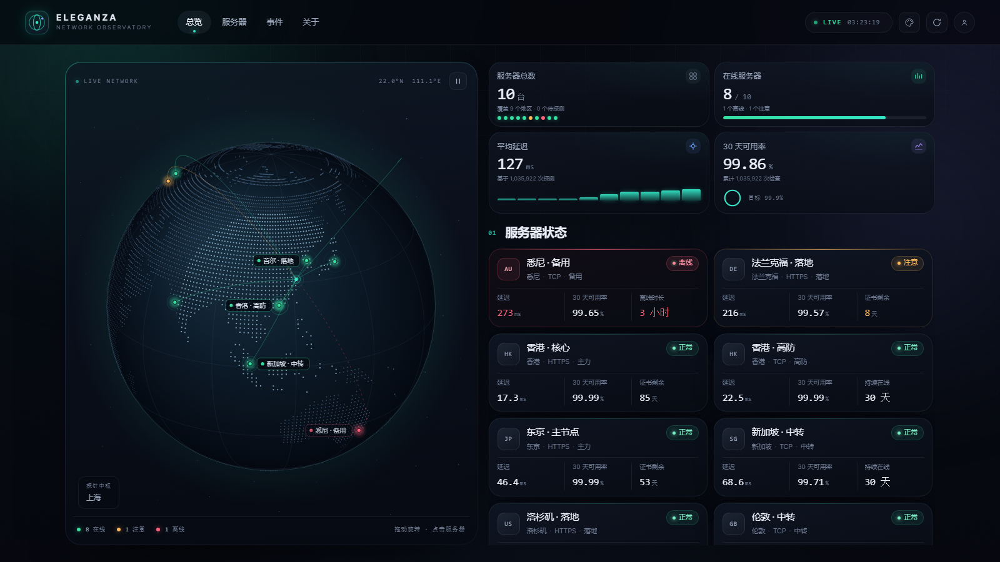
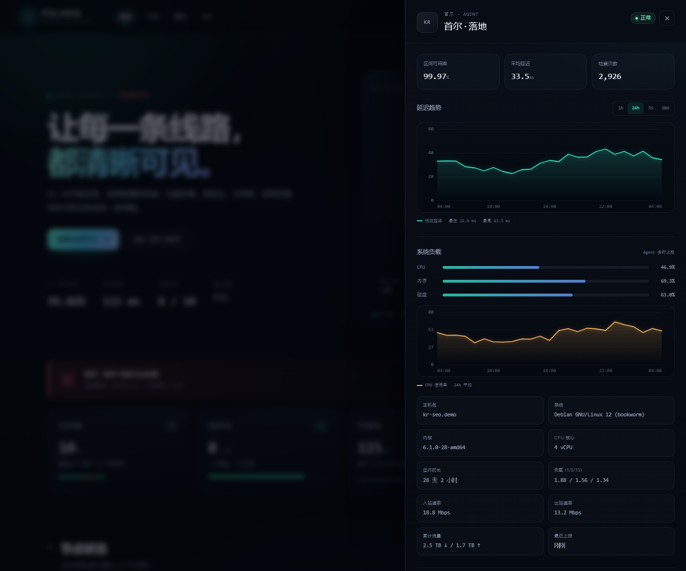
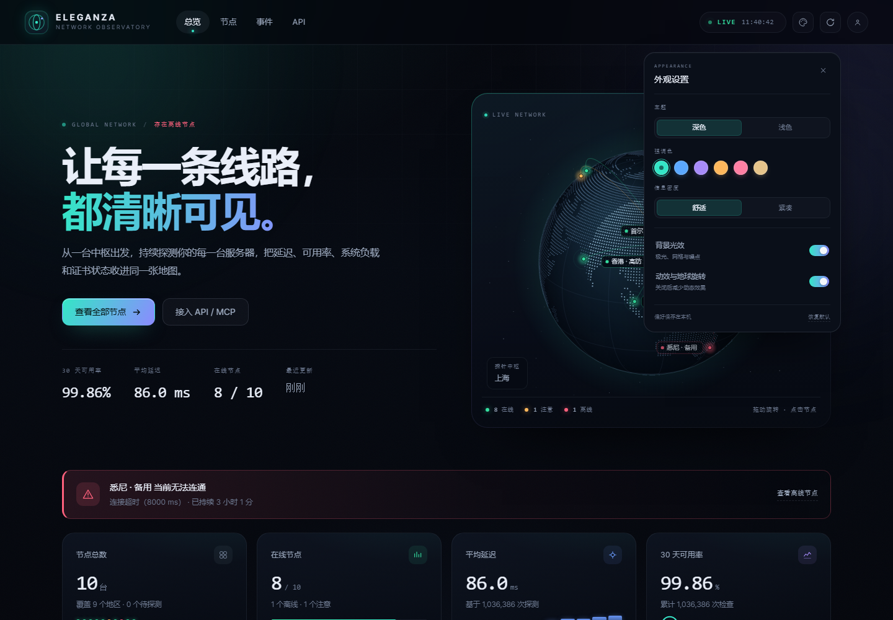
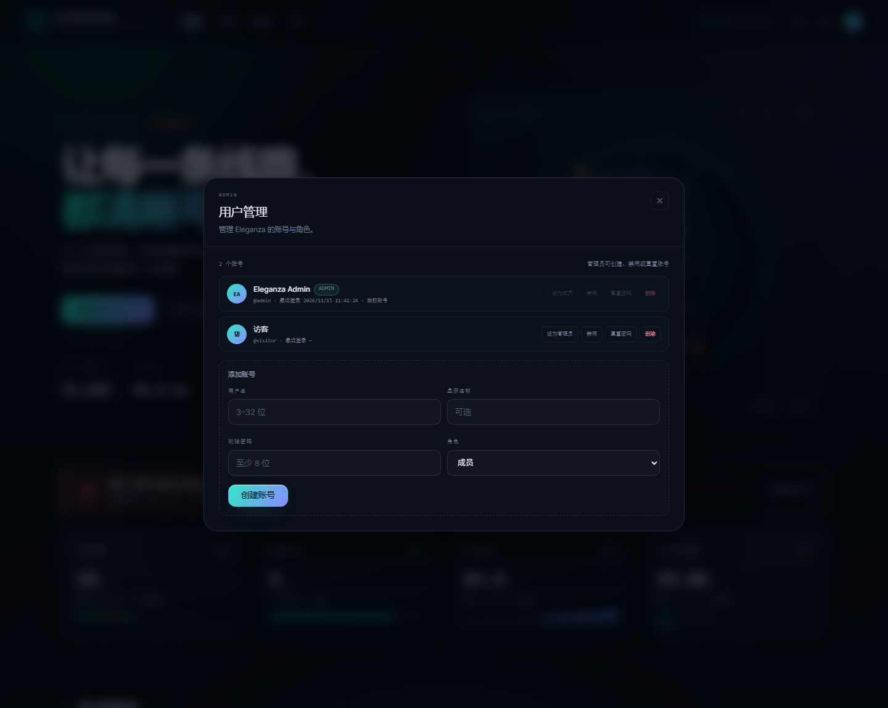
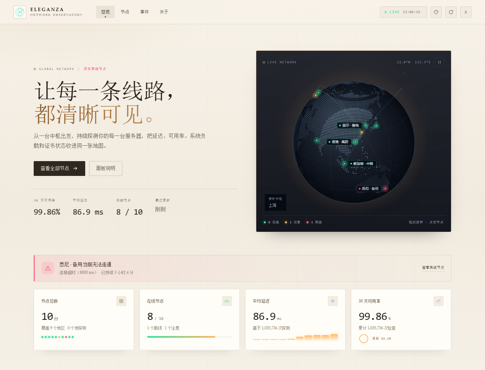
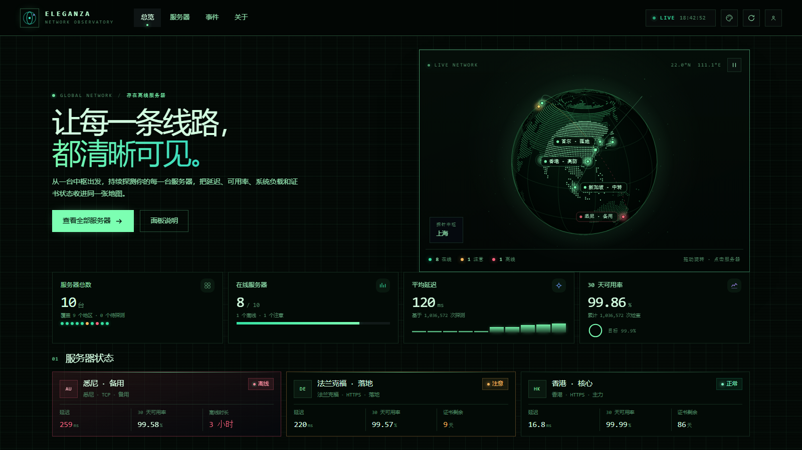

# Eleganza · 全球节点探针面板

> 一个类似 [Meridian](https://github.com/Dokoyamo-Lisa/Meridian) 状态页面的轻量探针面板：
> 实时 3D 地球、延迟与可用率曲线、30 天历史、Agent 资源上报、账号系统，以及四套完整的视觉风格。
>
> **零第三方依赖**：后端只用 Node.js 内置模块，前端原生 HTML/CSS/JS，不需要构建。



## 这是什么

Eleganza 把自己定位成 **只读的观测面板**，不接管代理协议、用户和订阅：

| | Meridian / Rosélune | Eleganza |
|---|---|---|
| 定位 | 代理 / VPN 管理面板 | 探针与状态页 |
| Xray / Hysteria2 / WireGuard 部署 | 有 | 无 |
| 代理用户、订阅、流量计费 | 有 | 无（只有面板账号） |
| 实时地球、延迟、可用率、30 天历史 | 有 | 有 |
| CPU / 内存 / 磁盘 / 服务状态 | 有 | 通过 Agent 上报 |
| 对外 API / MCP | 有 | 无（有意移除） |
| 依赖 | Go 服务端 + Agent | 一个 Node 进程 |

如果你已经用 3x-ui、XrayR 或自己的脚本管节点，只缺一个“一屏看全部”的状态页，Eleganza 就是为这个场景写的。
如果你需要创建用户、生成订阅、管理协议，应该直接用 Meridian 或 3x-ui。

### 功能

- **实时地球**：纯 Canvas 绘制的 3D 点阵地球，节点脉冲、中枢弧线、鼠标拖动旋转、点击节点打开详情。
- **两种探针**：服务端主动探测 HTTP / HTTPS / TCP，支持状态码白名单、关键字、TLS 证书天数；资源类指标由 Agent 反向推送。
- **30 天可用率**：按小时聚合的长期桶，按天着色；另有 1h / 24h / 7d / 30d 延迟曲线。
- **详情抽屉**：延迟趋势、区间可用率、TLS 证书、系统负载、服务状态、历史事件、节点元信息。
- **事件时间线**：连续失败达到阈值后自动开事件，恢复后自动闭环，并记录持续时长。
- **通知**：故障 / 恢复可推送通用 Webhook 或 Telegram。
- **账号系统**：首次启动初始化管理员，支持管理员 / 成员、登录会话、创建与禁用账号、重置密码；可选开放注册。
- **整体风格**：右上角调色板切换「深空 / 纸境 / 终端 / 鎏金」四套完整视觉风格，连带字体、卡片形状、背景、弹窗和详情抽屉一起变化；另有 7 种强调色、密度、光效与动效。
- **无对外接口**：不提供 REST API / MCP，面板只通过同源页面读取数据；Agent 上报使用独立 agentKey。
- **能屈能伸**：`npm run demo` 直接看演示；正式环境一个 `config.json` + 一条 `node server.mjs` 即可。












## 架构

```text
                        ┌──────────────────────────────┐
   浏览器 ──────────────▶│  Eleganza（单进程 Node）        │
                        │  · 静态页 + 同源数据读取      │
                        │  · 主动 HTTP / TCP 探针        │
                        │  · 内存桶 + data/state.json   │
                        └───────┬──────────────▲────────┘
                                │              │
                  主动探测      │              │  Agent 反向上报
              ┌─────────────────▼──┐      ┌────┴─────────────────┐
              │ 有公网入口的节点     │      │ IPv6-only / CGNAT 节点│
              │ HTTP / TLS / TCP   │      │ CPU / 内存 / 磁盘 / 流量│
              └────────────────────┘      └──────────────────────┘
```

- **能主动连的机器**：直接配 `https` / `tcp`，由面板发起探测。
- **连不进去的机器**（纯 IPv6、100.64.x CGNAT、只放行出站）：用 Agent 往外推送。
- 面板只读取探测结果，不转发任何用户流量。

## 快速开始

要求：**Node.js ≥ 20.11**（推荐 22 LTS）。项目没有 `npm install` 步骤。

### 1. 先看演示

```bash
git clone <this-repo> eleganza && cd eleganza
npm run demo
# 打开 http://127.0.0.1:8787
```

演示模式使用生成的节点与历史数据，不发起真实探测，方便先看 UI。演示配置在 `config.demo.json`，内置两个账号：

| 账号 | 密码 | 角色 |
|---|---|---|
| `admin` | `eleganza` | 管理员 |
| `visitor` | `visitor123` | 成员 |

演示模式的账号也会显示在登录弹窗里。正式环境不会生成这些默认密码。

### 2. 正式使用

```bash
cp config.example.json config.json
vim config.json           # 改成你的节点
node server.mjs
```

默认只监听 `127.0.0.1:8787`。从本机访问 `http://127.0.0.1:8787`，或按下面的反向代理一节暴露到公网。

```bash
# 指定端口 / 地址
ELEGANZA_HOST=0.0.0.0 ELEGANZA_PORT=8080 node server.mjs
node server.mjs --config /etc/eleganza/config.json --port 8787
```

### 3. Linux 一行安装（systemd）

要求：Linux + systemd + Node.js >= 20.11。

```bash
curl -fsSL https://raw.githubusercontent.com/TCNNM/eleganza/main/deploy/install-panel.sh \
  | sudo bash
```

脚本会：

- 下载源码到 `/opt/eleganza`
- 创建系统用户 `eleganza`
- 生成 `config.json`、`data/` 和 systemd 服务
- 启动面板并做健康检查
- 打印首次初始化令牌

安装完成后：

```bash
sudo nano /opt/eleganza/config.json   # 添加节点
sudo systemctl restart eleganza
sudo systemctl status eleganza --no-pager
```

自定义目录或端口：

```bash
curl -fsSL https://raw.githubusercontent.com/TCNNM/eleganza/main/deploy/install-panel.sh \
  | sudo env ELEGANZA_DIR=/opt/eleganza ELEGANZA_PORT=8787 bash
```

> 面板只监听 `127.0.0.1`。公网访问仍需 Caddy / Nginx 反向代理，并在 `config.json` 里设置 `site.trustProxy: true`。  
> 如果不想用 root 管道脚本，可先下载检查：`curl -fsSL ... -o /tmp/install-panel.sh && less /tmp/install-panel.sh && sudo bash /tmp/install-panel.sh`。

### 4. Docker

```bash
mkdir -p data
cp config.example.json config.json
vim config.json

# 镜像内以 node 用户（UID 1000）运行，data 目录需要可写
sudo chown -R 1000:1000 data
docker compose up -d --build
curl http://127.0.0.1:8787/healthz

# 首次创建管理员（二选一）
docker compose exec eleganza node tools/create-admin.mjs admin
# 或打开面板，使用容器日志里打印的初始化令牌：
docker compose logs eleganza | grep -A2 "初始化令牌"
```

`docker-compose.yml` 只把端口绑在 `127.0.0.1`，并开启只读根文件系统、`no-new-privileges`、`cap_drop: ALL`。对外请用 Caddy / Nginx 提供 HTTPS。

### 5. 手动 systemd

```bash
sudo useradd --system --home /opt/eleganza --shell /usr/sbin/nologin eleganza
sudo mkdir -p /opt/eleganza
sudo cp -r server.mjs src public tools package.json config.json /opt/eleganza/
sudo chown -R eleganza:eleganza /opt/eleganza
sudo cp deploy/eleganza.service /etc/systemd/system/
sudo systemctl daemon-reload
sudo systemctl enable --now eleganza

# 首次创建管理员（二选一）
cd /opt/eleganza && sudo -u eleganza node tools/create-admin.mjs admin
# 或打开面板用 systemctl status 里打印的初始化令牌
```

如果 `node` 不在 `/usr/bin/node`，修改 `deploy/eleganza.service` 里的 `ExecStart`。

## 配置

顶层只有 `site`、`accounts`、`thresholds`、`notifications`、`targets` 和可选的 `dataDir` / `demo`。

### site

| 字段 | 默认 | 说明 |
|---|---|---|
| `title` | `Eleganza` | 页面标题 |
| `subtitle` | 全球节点 · 实时探针 | 副标题 |
| `tagline` | 让每一条线路，都清晰可见。 | 首页主文案 |
| `description` | 一段说明 | 首页描述 |
| `footer` | 自建探针面板 | 页脚文字 |
| `hub` | 探针中枢（上海） | 地球上的“探针中枢”坐标：`{ name, lat, lon }` |
| `refreshSeconds` | `10` | 节点默认探测间隔（每个节点可单独覆盖） |
| `showAddress` | `false` | 是否公开真实地址；默认打码 |
| `showDetails` | `true` | 是否公开失败原因 |
| `trustProxy` | `false` | 是否信任 `X-Forwarded-For` / `X-Forwarded-Proto`（反代后设为 true） |
| `historyDays` | `35` | 历史桶保留天数（30–90） |

> 旧版的 `site.public: false` 仍然兼容，等同于 `accounts.required: true`；新配置建议直接使用 `accounts.required`。

### accounts

| 字段 | 默认 | 说明 |
|---|---|---|
| `required` | `false` | `true` 时整个面板的数据都需要登录 |
| `allowRegistration` | `false` | 是否允许访客自行注册成员账号 |
| `sessionHours` | `168` | 登录会话有效期（1–8760 小时） |
| `setupToken` | 空 | 首次初始化管理员的一次性令牌；留空时启动随机生成并打印在终端 |

### thresholds

| 字段 | 默认 | 作用 |
|---|---|---|
| `latencyWarnMs` | `350` | 超过后节点状态变“注意” |
| `cpuWarnPercent` | `80` | Agent CPU 告警阈值 |
| `memWarnPercent` | `85` | 内存告警阈值 |
| `diskWarnPercent` | `90` | 磁盘告警阈值 |
| `tlsWarnDays` | `14` | 证书剩余天数告警 |
| `failureThreshold` | `2` | 连续失败几次后判定离线并开事件 |

### targets

| 字段 | 适用 | 说明 |
|---|---|---|
| `id` | 必填 | 唯一，字母数字 `._-` |
| `name` | 必填 | 展示名称 |
| `type` | 必填 | `https` / `http` / `tcp` / `agent` |
| `url` | HTTP(S) | 完整 URL，例如 `https://example.com/health` |
| `host` / `port` | TCP / Agent | TCP 目标地址；Agent 可只写 `host` 展示 |
| `intervalSeconds` | 全部 | 5–3600，默认跟随 `site.refreshSeconds` |
| `timeoutMs` | 全部 | 1000–30000 |
| `expectStatus` | HTTP(S) | 允许的状态码数组，默认 2xx/3xx |
| `keyword` | HTTP(S) | 响应正文必须包含的关键字 |
| `allowInsecure` | HTTPS | 跳过证书校验（自签证书） |
| `agentKey` | Agent | 必填，每个节点一个随机串 |
| `country` / `city` / `group` | 全部 | 卡片与地球位置信息 |
| `lat` / `lon` | 全部 | 地球经纬度；不填则不上地球 |
| `tags` | 全部 | 展示标签 |
| `services` | Agent | 要检查的 systemd / OpenRC 单元名 |
| `hidden` | 全部 | 从面板隐藏 |
| `note` | 全部 | 备注 |

示例：

```json
{
  "id": "hk-core",
  "name": "香港 · 核心",
  "type": "https",
  "url": "https://hk.example.com/healthz",
  "country": "HK",
  "city": "香港",
  "lat": 22.3193,
  "lon": 114.1694,
  "intervalSeconds": 20,
  "expectStatus": [200],
  "keyword": "ok",
  "tags": ["主力", "Reality"]
}
```

```json
{
  "id": "sg-agent",
  "name": "新加坡 · 落地",
  "type": "agent",
  "agentKey": "换成 openssl rand -hex 24 的输出",
  "country": "SG",
  "city": "新加坡",
  "lat": 1.3521,
  "lon": 103.8198,
  "intervalSeconds": 20,
  "services": ["nginx", "xray"]
}
```

> TCP 探针只测 TCP 连通性。Hysteria2 / WireGuard 是 UDP，无法用 TCP 探测；请用 Agent 上报进程状态，再从客户端侧另行验证。

### 账号系统

首次启动时还没有任何账号。安全流程是：

1. 启动服务，终端会打印一次性的 **初始化令牌**。
2. 打开面板 → 右上角账号头像 → 「初始化管理员」→ 填入令牌，设置用户名和密码。
3. 之后用该账号登录；管理员可以在「用户管理」中创建成员、禁用账号、重置密码或删除账号。

如果不想走网页流程，也可以直接在服务器上创建：

```bash
node tools/create-admin.mjs admin
# 交互输入密码；也可以 --password '...' --display-name '管理员'
# 重置已有账号密码：
node tools/create-admin.mjs admin --reset
```

建议在首次初始化完成前不要把面板暴露到公网；也可以把 `accounts.setupToken` 固定成一个随机串，避免每次重启生成新令牌。

把面板设为私有：

```json
{
  "site": { "trustProxy": true },
  "accounts": {
    "required": true,
    "allowRegistration": false,
    "sessionHours": 168,
    "setupToken": ""
  }
}
```

账号文件在 `data/accounts.json`，密码使用 scrypt（随机盐）存储，会话令牌只保存 SHA-256 摘要，Cookie 为 `HttpOnly` + `SameSite=Lax`。账号接口有登录限速，修改类接口会校验同源 Origin。

账号能力：

- 管理员：面板数据、账号管理、所有设置
- 成员：面板数据、个人资料与密码、自己的外观偏好
- 未登录（`required: false` 时）：只读浏览公开状态；外观偏好保存在浏览器本地
- 登录后修改的外观偏好会写入账号，换浏览器登录也能恢复

初始化后，建议用管理员账号在「用户管理」中为每位同事创建单独账号，不要共用 `admin`。

### 外观定制

右上角刷新按钮左侧的调色板按钮打开外观面板：

- **整体风格**：深空（玻璃 + 极光）、纸境（暖白编辑排版 + 衬线字体）、终端（等宽 + 网格 + 直角）、鎏金（深色 + 香槟金 + 衬线标题）
- **强调色**：薄荷、天青、紫罗兰、琥珀、玫瑰、香槟、青柠
- **信息密度**：舒适 / 紧凑
- **背景光效**：极光、网格与噪点开关
- **动效与地球旋转**：关闭后减少动画并暂停地球自转

风格不是换一层颜色：顶栏、首页大字、卡片圆角与边框、按钮、弹窗、详情抽屉、图表背景和整体排版都会一并切换。已登录时偏好写入 `data/accounts.json` 并跟随账号；未登录时保存在当前浏览器的 localStorage。

### 通知

```json
{
  "notifications": {
    "webhookUrl": "https://example.com/hooks/eleganza",
    "telegram": { "botToken": "123:ABC", "chatId": "123456789" },
    "notifyOnRecovery": true,
    "timeoutMs": 8000
  }
}
```

- Webhook 收到 `{ source, event, sentAt, node, incident }`，`event` 为 `incident.opened` 或 `incident.resolved`。
- 通知在事件开/关时异步发送，失败只写日志，不影响探测。
- 想接飞书 / 钉钉 / Slack，用 `webhookUrl` 指向你的转发服务即可。

## Agent

Agent 是一个纯 Bash 脚本，适用于大多数 Linux。`install-agent.sh` 面向 systemd（Debian / Ubuntu / Rocky 等）；Alpine 等 OpenRC 系统请手动把脚本和 env 文件放好，并用 OpenRC 或 supervisor 常驻。

### 一行安装（SSH 中直接粘贴）

先在面板 `config.json` 里给节点填好 `agentKey`，然后在**目标服务器**的 SSH 里执行：

```bash
curl -fsSL https://raw.githubusercontent.com/TCNNM/eleganza/main/agent/install-agent.sh \
  | sudo env ELEGANZA_SERVICES="nginx xray" ELEGANZA_MOUNTS="/ /var" \
    bash -s -- https://status.example.com <AGENT_TOKEN>
```

不需要检查服务时：

```bash
curl -fsSL https://raw.githubusercontent.com/TCNNM/eleganza/main/agent/install-agent.sh \
  | sudo bash -s -- https://status.example.com <AGENT_TOKEN>
```

脚本会自动下载 Agent 和 systemd 单元，写入 `/etc/eleganza-agent.env`，然后启动 `eleganza-agent`。

如果更谨慎，先下载再检查，最后执行：

```bash
curl -fsSL https://raw.githubusercontent.com/TCNNM/eleganza/main/agent/install-agent.sh \
  -o /tmp/install-eleganza-agent.sh
less /tmp/install-eleganza-agent.sh
sudo ELEGANZA_SERVICES="nginx xray" ELEGANZA_MOUNTS="/ /var" \
  bash /tmp/install-eleganza-agent.sh https://status.example.com <AGENT_TOKEN>
```

### 本地仓库安装

```bash
# 在面板配置里给节点填好 agentKey，然后在目标机上：
sudo ELEGANZA_SERVICES="nginx xray" \
     ELEGANZA_MOUNTS="/ /var" \
     ./agent/install-agent.sh https://status.example.com <AGENT_TOKEN>

# 看日志
journalctl -u eleganza-agent -f
```

也可以手动运行：

```bash
ELEGANZA_URL=https://status.example.com \
ELEGANZA_TOKEN=<AGENT_TOKEN> \
ELEGANZA_SERVICES="nginx xray" \
ELEGANZA_MOUNTS="/" \
bash agent/eleganza-agent.sh --once

# 只打印将上报的 JSON（排查用）
ELEGANZA_URL=https://... ELEGANZA_TOKEN=... bash agent/eleganza-agent.sh --print
```

上报内容：主机名、系统、内核、运行时长、CPU 使用率 / 核心数 / 型号、内存、挂载点使用率、网卡累计流量、负载、systemd / OpenRC 服务状态。间隔由 `ELEGANZA_INTERVAL` 控制，最小 5 秒。

安装文件：

- `agent/eleganza-agent.sh`：脚本本体
- `agent/eleganza-agent.env.example`：环境变量示例（安装后为 `/etc/eleganza-agent.env`，权限 600）
- `agent/eleganza-agent.service`：systemd 单元
- `agent/install-agent.sh`：一键安装

Agent 是**只读**的：只读取 `/proc`、`df` 和 `systemctl is-active`，不会修改系统；但 unit 默认以 root 运行（服务状态检查最省事），已加 `ProtectSystem=strict` 等加固。不需要服务检查时可以把 `ELEGANZA_SERVICES` 留空，并考虑改成非 root 用户。

## 接口策略

Eleganza **不提供对外 REST API，也不提供 MCP**。面板通过同源页面读取服务端数据，账号、外观偏好和 Agent 上报都使用内部端点；这些端点不对外承诺兼容性，也不提供公开 Token。

这样做的取舍：

- 面板只面向内部观测与账号协作，避免把节点信息再次复制到更多系统；
- 减少 Token、跨域和权限配置面；
- Agent 仍通过每个节点独立的 `agentKey` 上报，这是探针运行所必需的；
- 如果确实需要自动化导出，可以在服务器本地读取 `data/state.json`，或另外部署采集服务。

## 暴露到公网

面板自身只监听 `127.0.0.1`，建议用 Caddy 或 Nginx 终止 TLS：

```bash
sudo cp deploy/Caddyfile.example /etc/caddy/Caddyfile
sudo systemctl reload caddy
```

Caddyfile / Nginx 示例都在 `deploy/`。使用反向代理时：

1. 把 `site.trustProxy` 设为 `true`；
2. 确认 `X-Forwarded-Proto` 被正确传递（示例已配置）；
3. 只有这样才能得到正确客户端 IP、`Secure` Cookie 和 HSTS。

安全建议：

- 不要把面板端口直接暴露公网；先在 TLS 后面，再考虑 `accounts.required: true`。
- 首次初始化完成前不要公网暴露；初始化令牌只在终端打印。
- 管理员密码用 16 位以上随机串，不要与任何外部服务复用。
- 每个成员使用独立账号，不共用管理员；离职后禁用或删除账号。
- 每个 Agent 使用独立 `agentKey`；泄露后只改该节点并 reload。
- 定期备份 `config.json` 和 `data/`（`accounts.json` 也在 `data/`）。
- 面板不代理流量，但仍会暴露节点名称、地区和可用率；`showAddress: false` 会打码地址，但 TLS 证书的 subject 仍可能包含域名。

## 数据与保留

- 内存是主存储，`data/state.json` 每 20 秒原子快照一次（先写临时文件再 rename），进程退出时也会保存。
- 每台节点保留最近 35 天的**小时桶**（在线数、检查数、延迟求和、CPU/内存/磁盘、流量增量）和最近 180 个原始采样。
- 事件最多保留 300 条。
- 账号与会话保存在 `data/accounts.json`；密码是 scrypt 哈希，会话只保存摘要。删除它等于清空所有账号，下次启动会重新进入管理员初始化流程。
- 想清空节点历史：停止服务，删除 `data/state.json`。账号文件不受影响。
- 演示数据在 `data/demo/`，正式数据在 `data/`，互不影响。

## 项目结构

```text
eleganza/
├── server.mjs              # CLI 入口：加载配置、启动探针/演示、监听
├── src/
│   ├── app.mjs             # HTTP 路由：静态页、同源数据、账号
│   ├── config.mjs          # 配置校验与归一化
│   ├── store.mjs           # 采样、小时桶、30 天、事件、持久化
│   ├── probe.mjs           # HTTP / HTTPS / TCP 探针与调度器
│   ├── demo.mjs            # 确定性演示数据
│   ├── accounts.mjs        # 账号、scrypt 密码、会话、权限
│   ├── notify.mjs          # Webhook / Telegram
│   └── util.mjs
├── public/
│   ├── index.html          # 单页结构
│   ├── style.css           # 设计系统与响应式
│   ├── appearance.css      # 主题、外观面板、账号弹窗、用户管理
│   ├── theme.js            # 外观偏好、强调色、localStorage
│   ├── theme-boot.js       # 首屏应用主题，避免闪烁
│   ├── app.js              # 数据获取、渲染、抽屉、账号与外观交互
│   ├── globe.js            # Canvas 3D 点阵地球
│   ├── charts.js           # SVG 迷你曲线 + Canvas 时序图
│   └── globe-land.js       # 由 Natural Earth 110m 生成的点阵（构建产物）
├── assets/land-110m.json   # Natural Earth 110m 陆地拓扑（点阵数据源）
├── agent/                  # Bash Agent + systemd + 安装脚本
├── deploy/                 # 一键安装、systemd、Nginx / Caddy 示例
├── test/                   # node:test 单元与集成测试
├── tools/
│   ├── build-globe.mjs     # TopoJSON → 点阵位图
│   ├── create-admin.mjs    # 创建管理员 / 重置密码
│   └── screenshot.mjs      # 可选的 CDP 截图工具
├── config.demo.json
├── config.example.json
├── Dockerfile
└── docker-compose.yml
```

## 开发

```bash
npm test          # 29 个测试：配置、探针、存储、账号、界面、通知
npm run demo      # 演示模式
npm run build:globe
```

> 测试使用 `node --test --test-isolation=none`（Node 22.8+）。默认的 `node --test` 会为每个测试文件再启动一个 Node 进程，在某些受限沙箱里会被拒绝；同进程运行没有这个问题。Node 20 上可以逐个运行 `node test/*.test.mjs`。

前端没有构建步骤；改了 `public/` 刷新即可。改地球数据后运行 `npm run build:globe`，会从 `assets/land-110m.json` 重建 `public/globe-land.js`。

`tools/screenshot.mjs` 是一个可选的开发脚本，配合 `msedge --headless --remote-debugging-port=9222` 使用，用于生成 README 截图，不影响运行。

## 常见问题

**Agent 一直显示“待探测”**
先确认 `config.json` 里的 `agentKey` 与 `/etc/eleganza-agent.env` 的 `ELEGANZA_TOKEN` 完全一致，再 `journalctl -u eleganza-agent -f` 看是否 401。Agent 第一次上报前就是待探测状态。

**节点在线但 30 天可用率是 0**
该节点刚加入，还没有跨小时的桶；等一小时或看 1h 曲线。演示模式会预填 30 天数据。

**纯 IPv6 / CGNAT 节点探测不到**
面板主动探测需要能路由到目标。这类机器请用 `type: "agent"`，让目标主动往外推。

**Hysteria2 / WireGuard 显示离线**
TCP 探针测不了 UDP。把节点改成 Agent，用 `services` 检查进程，再从客户端侧验证实际连通。

**首次打开没有账号 / 不知道初始化令牌**
首次启动时终端会打印一次性的初始化令牌；重启会重新生成。也可以不用 UI，直接运行 `node tools/create-admin.mjs admin`。如果令牌丢失，重启服务后看日志。

**忘记管理员密码**
在服务器上运行 `node tools/create-admin.mjs admin --reset`；如果用户名不是 admin，换成实际用户名。其他成员的密码可以由管理员在「用户管理」里重置。

**登录后外观设置没有跟随账号**
外观改动会先立即生效，再延迟同步到账号；确认已经登录（右上角头像不是访客图标）。未登录时只保存在当前浏览器 localStorage。

**旧版的访问密码不生效了**
1.1.0 起改为账号系统，旧的 `auth.passwordSha256` 不再使用。请用 `tools/create-admin.mjs` 创建管理员，或在面板首次初始化。旧密码不会被迁移。

**反向代理后登录刷新又掉线**
把 `site.trustProxy` 设为 `true`，并确认代理传递了 `X-Forwarded-Proto: https`；否则 Cookie 不会带 `Secure`（或不匹配）。

**收不到通知**
检查 `notifications.webhookUrl` / Telegram 配置；发送失败只写日志，不影响面板。先用一个 `nc -l` 或 webhook.site 验证连通性。

**地球上看不到某些节点**
地球只渲染朝向镜头的一面，拖动旋转即可；标签在重叠时会自动隐藏部分，点击节点或卡片仍可查看详情。

**为什么没有用户 / 订阅 / 流量计费**
这不是代理面板。Eleganza 只做观测；需要这些能力请使用 Meridian、3x-ui 或 Marzban。

## License

MIT. 地球点阵使用 Natural Earth 110m 陆地数据（public domain），通过 [world-atlas](https://github.com/topojson/world-atlas) 转换。
